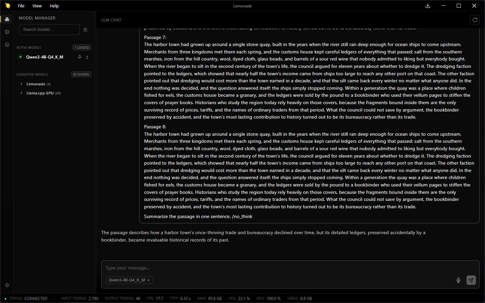
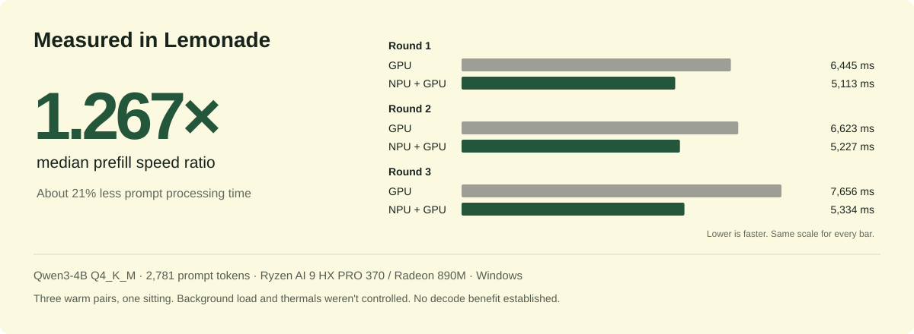

  <a href="https://lemonade-server.ai/">
    <picture>
      <source media="(prefers-color-scheme: dark)" srcset="docs/assets/lemonade-logo-dark.png">
      
    </picture>
  </a>

# Zest: use your NPU in Lemonade

Zest accelerates long prompts for **many GGUF models through Lemonade's
llama.cpp backend**, using your AMD Ryzen AI NPU. The GPU handles attention
and writes the reply.

Use your existing GGUF files. No ONNX or Q4NX export is required, and there's
no NPU kernel to compile for each model. Qwen, LFM, and Granite are examples,
rather than a fixed list of supported models. Coverage depends on the bundled
llama.cpp build and the operations the add-on implements; speedups vary by model.

**[Download the Windows preview](https://github.com/Cyronius/zest/releases/tag/v0.2.0-rc2)**
· [Setup guide](docs/lemonade.md)
· [Website](https://cyronius.github.io/zest/)
· [Direct llama.cpp / Linux](docs/technical-guide.md)

This is an independent community add-on. The tested preview uses
Lemonade **2026.43.3** and the bundled **llama.cpp b10944** backend.
Current packages use `ggml-zest.dll` on Windows and `libggml-zest.so` on Linux.
[Moving from ggml-xdna?](docs/zest-migration.md) The `npu` command remains available
as a compatibility alias for `zest`.
Keep that backend together: the DLL won't work with an arbitrary newer build.

## See it running

[Watch the 19-second walkthrough](https://github.com/Cyronius/zest/releases/download/lemonade-preview-20261021/lemonade-desktop-walkthrough.mp4)
· [NPU trace](docs/results/lemonade-desktop-trace.txt)
· [Verification report](docs/lemonade-validation.md)

That's the actual Lemonade app. It loaded Qwen3-4B, answered a 2,780-token
prompt, and logged 344 NPU calls. The video is a walkthrough made from
desktop screenshots, so don't use it to judge latency.

## Try it on Windows

You'll need Windows 11, an AMD Ryzen AI NPU with its driver, a Vulkan GPU
driver, [Lemonade 2026.43.3](https://github.com/lemonade-sdk/lemonade/releases/tag/v2026.43.3),
and a GGUF file already on disk. We tested a Ryzen AI 9 HX PRO 370 with
Radeon 890M graphics. Qwen3-4B Q4_K_M is a useful starting point if you want
to repeat that test. Lemonade, drivers, and model weights are separate downloads.

1. [Download the Windows preview](https://github.com/Cyronius/zest/releases/tag/v0.2.0-rc2)
   and extract the ZIP. Keep the files together. There's a SHA-256 checksum
   beside the download and a file manifest inside it.
2. Quit the existing Lemonade tray server, then double-click
   **`Start-Lemonade.cmd`** in the extracted folder. It looks for Lemonade
   and asks you to find its server executable if needed. Choose your GGUF
   file when asked, and leave the launcher window open.
3. Open Lemonade App. In **Settings → Base URL**, enter
   **`http://127.0.0.1:13315`** and click **Save**. Select your imported model
   in the chat picker and try a long prompt.

The launcher keeps its configuration separate and uses the GPU if the NPU
can't start. To go back to your regular setup, stop this server with Ctrl+C,
restart your normal Lemonade server, and restore the app's previous Base URL
(normally `http://localhost:13305`).

The [setup guide](docs/lemonade.md) also covers terminal commands, portable
Lemonade, logs, and troubleshooting. If you're running from source, build
with `build.cmd` first.

## What the NPU does

| Work | Processor |
|---|---|
| Eligible matrix multiplies and nearby operations in large prompt chunks | NPU |
| Attention, small prompt chunks, and reply generation | Vulkan GPU |

The gain comes while the model reads your prompt, usually called *prefill*.
Reply generation stays on the GPU. Chunks below 1,024 tokens normally stay
there too, so a quick greeting may show no NPU activity. The first long
request can take longer while the NPU finishes converting its weight copies.

## What we measured in Lemonade on Strix Point

**Test hardware: Strix Point — Ryzen AI 9 HX PRO 370 / Radeon 890M.**
This is the smaller laptop GPU, with 16 compute units. High-end Strix Halo's
Radeon 8060S has 40; it is a much larger GPU platform. We haven't measured
Zest on Halo, and its faster GPU could change the NPU's relative benefit.
[AMD hardware specifications](https://rocm.docs.amd.com/en/latest/reference/gpu-specs.html).

| Model / GGUF | Prompt tokens | GPU only (tok/s) | NPU + GPU (tok/s) | Paired speedup (range) | Answer checks, GPU / NPU |
|---|---:|---:|---:|---:|---|
| Qwen3.8-27B UD-IQ3_S | 2,769 | 50 | 74 | **1.54×** (1.47–1.55) | 3/3 · 3/3 |
| LFM2.5-2.6B Q8_0 | 2,823 | 772 | 1,190 | **1.54×** (1.11–1.57) | 3/3 · 3/3 |
| Qwen3-4B Q4_K_M | 2,785 | 415 | 597 | **1.46×** (1.44–1.60) | 3/3 · 3/3 |
| LFM2.5-1.2B-Instruct Q8_0 | 2,846 | 1,769 | 2,600 | **1.46×** (1.44–1.48) | 2/3 · 2/3 |
| LFM2.5-350M Q8_0 | 2,846 | 5,338 | 5,897 | **1.14×** (1.05–1.15) | 2/3 · 2/3 |
| Bonsai 2 2B Q2_0 | — | — | — | Unsupported: garbled output | 0/3 · 0/3 |

Three warm pairs per model, using the same prose through Lemonade. Throughput columns are medians; speedups are medians of paired ratios. The checks cover two retrieved facts and one arithmetic question, not general model quality. The small LFM models missed the arithmetic in both modes.

Qwen3.8-27B also reached **1.90×** median speedup on a separate, aligned **2,048-token prompt** (50 → 91 tokens/s). Bonsai 2 loads but produces garbled output in this pinned backend, so it has no usable speed result here.

These are warm prefill timings, excluding model load and weight conversion. They do not establish a decode benefit or compare with Lemonade's current default GPU backend.

[Full comparison, method, and model files](docs/model-comparison.md) · [Raw results and traces](docs/results/headline-models-2026-10-21/)

Earlier Qwen3-4B desktop-era comparison

Qwen3-4B Q4_K_M read a 2,781-token prompt at a median **1.267×** the GPU-only
speed, or about **21% less prefill time**. That's three warm pairs on one
laptop in one sitting. Background load and thermals weren't controlled, and
we haven't shown a decode benefit or compared this with Lemonade's current
default GPU backends. Try your own model before assuming it'll be faster.

[Full responses and hashes](docs/results/lemonade-2026-10-21.json)
· [NPU trace](docs/results/lemonade-2026-10-21-npu-trace.txt)
· [Repeat the comparison](docs/lemonade.md#measure-your-model)
· [Standalone model benchmarks](docs/technical-guide.md#results)

## Before you use the preview

| Item | What we've checked |
|---|---|
| Windows 11, Ryzen AI 9 HX PRO 370 / Radeon 890M | Actual Lemonade desktop and API tests |
| Lemonade / backend | 2026.43.3 / bundled b10944 Vulkan build |
| Other Ryzen AI hardware, including Strix Halo | Not tested by this project |
| Linux | Builds and host tests pass; NPU hardware and Lemonade integration remain unverified |
| Models | Coverage depends on b10944 and the operations the add-on implements |
| Memory and output | Converted weight copies need extra RAM; block rounding changes numerical results |
| NPU unavailable at startup | Launcher chooses the GPU and logs the reason |
| NPU failure during a request | Failed work is retried on GPU; later prompts use the GPU |

The r2 preview includes the GPU recovery fix already merged into this
project. The original preview fell back to CPU and took about 63 seconds
on an injected failure; that older result is kept in the test report.
GPU-only and NPU-assisted runs answered the retrieval and arithmetic checks
correctly, but both returned an equation when asked for just an integer.
The [verification report](docs/lemonade-validation.md) includes those failures,
and the [technical guide](docs/technical-guide.md#limitations) covers the
memory, accuracy, and model limits in more detail.

## Help and direct llama.cpp use

- [Lemonade setup and troubleshooting](docs/lemonade.md)
- [Quality checks and benchmarks](docs/lemonade.md#measure-your-model)
- [Direct llama.cpp on Windows](docs/technical-guide.md#quick-start) and
  [Linux](docs/technical-guide.md#linux), both still supported
- [Build instructions, tuning, and architecture](docs/technical-guide.md)
- [Report a problem](https://github.com/Cyronius/zest/issues/new) with
  your processor, drivers, Lemonade version, model, and launcher logs

MIT licensed. [License](LICENSE) · [Dependency and logo attribution](NOTICE).
The Lemonade logos are from its [official brand kit](https://github.com/lemonade-sdk/assets/tree/main/brand-kit).
